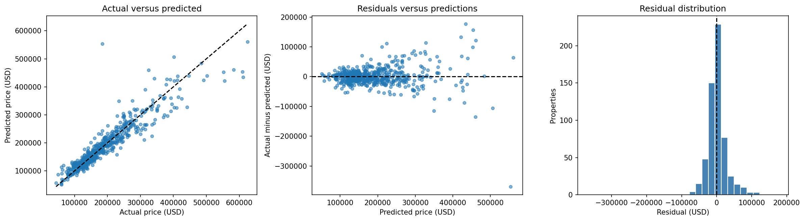

# Ames House Price Prediction

**Author: Tinashe Clifford Makandise**  
Python · pandas · scikit-learn · Streamlit

An end-to-end regression project estimating historical residential sale prices in Ames, Iowa. Five explained notebooks cover data inspection, exploration, preprocessing, model selection and final evaluation. A Streamlit app turns the evaluated model into an interactive estimator.

**Status:** runs locally; public deployment pending. Prices represent **2006–2010 Ames transactions in historical USD**.

## Results

The original 2,930-record dataset was split into 2,344 training properties and 586 held-out properties using a fixed seed. Fifteen configurations were compared using the same five training-only cross-validation folds. Mean validation MAE selected a Random Forest with expanded features, 100 trees and minimum leaf size 1.

| Held-out metric | Random Forest | Training-median baseline |
|---|---:|---:|
| MAE | $19,311 | $63,838 |
| RMSE | $32,792 | $94,323 |
| R² | 0.866 | −0.110 |

The selected model reduced holdout MAE by **69.7%** relative to the baseline. Its cross-validation MAE was $19,053. The exported model was fitted only on training properties, and its settings were frozen before holdout evaluation.



MAE is an average dollar error, not an individual guarantee. R² is not “percentage accuracy.” Some unusual properties have much larger errors.

## Problem and inputs

Estimate sale price from above-ground living area, bedrooms, full and half bathrooms, neighbourhood, age at sale and garage capacity. The expanded model also uses overall quality and condition.

- Area is living space in square feet, not land area.
- Room counts refer to above-ground rooms.
- Age is sale year minus construction year; the app explicitly uses a historical sale year.
- Garage capacity is spaces inside a garage, not all parking availability.

The application validates inputs, flags values outside training coverage, highlights sparsely represented locations and offers a downloadable JSON estimate. No calibrated prediction interval is provided.

## Method

1. Validate source structure and reserve the holdout before detailed exploration.
2. Explore training prices, property characteristics, missingness and unusual records.
3. Build shared feature functions and fold-specific preprocessing pipelines.
4. Compare a median baseline, Linear Regression, Ridge, Random Forest and limited log-target Ridge candidates.
5. Select by five-fold mean MAE in USD, evaluate once on the holdout, export the full pipeline and verify loading in a fresh process.

Numeric medians, scalers and category vocabularies are learned within training folds. Identifiers and sale price are excluded from predictors. Inconsistent negative derived ages become missing rather than causing row deletion. All source properties remain in the defined evaluation population.

## Run on Windows

Use Python 3.12 or 3.13 (64-bit). The model was trained under 3.12; the app has also run under 3.13 on Windows. A short environment path avoids Windows path-length installation errors.

Open Command Prompt inside this extracted repository. Run each line separately:

```bat
python -m venv "%USERPROFILE%\house-env"
"%USERPROFILE%\house-env\Scripts\python" -m pip install --timeout 120 --retries 10 -r requirements.txt
"%USERPROFILE%\house-env\Scripts\python" -m streamlit run app.py
```

If that environment already exists, reuse it. To reopen the installed app later, run only the final command from this folder. Open http://localhost:8501 and keep the terminal open.

For macOS/Linux:

```bash
python3.12 -m venv .venv
.venv/bin/python -m pip install -r requirements.txt
.venv/bin/python -m streamlit run app.py
```

The fitted model is included. Running the application requires no dataset download or retraining. Keep `src/`, `models/` and the app reports in their existing locations. Only load trusted joblib files and use the pinned dependency versions.

## Explore and reproduce

Install `requirements-dev.txt` in the environment for notebooks, charts and Jupyter. Download the original data as described in [data/raw/README.md](data/raw/README.md).

| Notebook | Purpose |
|---|---|
| [01 — Inspection](notebooks/01_project_overview_and_data_inspection.ipynb) | Scope, source validation, missingness and fixed train/test split |
| [02 — Exploration](notebooks/02_exploratory_data_analysis.ipynb) | Training-only visual analysis |
| [03 — Preprocessing](notebooks/03_preprocessing_and_feature_engineering.ipynb) | Shared feature and pipeline factories |
| [04 — Model comparison](notebooks/04_model_training_and_comparison.ipynb) | Cross-validation and frozen selection |
| [05 — Evaluation](notebooks/05_final_evaluation_and_model_export.ipynb) | Held-out evaluation and fitted model export |

Run the notebooks in order, with their working directory set to `notebooks/` or the repository root. Notebook 3 intentionally regenerates the shared feature modules. The processed data and split manifest are generated locally and excluded from Git.

To reproduce the selected training configuration without repeating the model search:

```bat
"%USERPROFILE%\house-env\Scripts\python" train.py --data data\raw\AmesHousing.txt
```

This verifies source bytes, recreates the training partition, trains the frozen model, checks predictions against the included reference and saves into `retrained-output/`. It does not overwrite the published model or recalculate test metrics. The reference test evaluation is in Notebook 5.

Run application checks:

```bat
"%USERPROFILE%\house-env\Scripts\python" -m unittest discover -s tests -v
```

## Repository contents

- `app.py`: Streamlit user interface.
- `src/`: feature construction, model factories and input validation.
- `train.py`: frozen training reproduction.
- `models/`: evaluated pipeline and metadata.
- `notebooks/`: all five notebooks with saved results.
- `reports/`: metrics, analysis summaries and figures.
- `docs/`: GitHub publishing and screenshot instructions.
- `tests/`: functional validation and application interaction checks.

## Limitations

This is a historical educational model, not a current appraisal system. It is not validated outside Ames, including Zimbabwe or South Africa. A random split assesses held-out properties from the same historical population, not future market forecasting. Sparse neighbourhoods and unusual properties have limited supporting evidence. Quality and condition ratings involve judgement. Feature importance describes model behaviour and does not establish causal effects.

The held-out data has now been examined. Future model revisions need an appropriate fresh evaluation design rather than repeated tuning to this test set.

## Dataset and attribution

The original Ames Housing dataset compiled by Dean De Cock contains 2,930 residential sales from 2006–2010 and 82 columns including identifiers and the target. This project uses the original dataset rather than the smaller Kaggle competition training subset.

De Cock, D. (2011). Ames, Iowa: Alternative to the Boston housing data as an end of semester regression project. *Journal of Statistics Education, 19*(3). https://doi.org/10.1080/10691898.2011.11889627

[Original study](https://jse.amstat.org/v19n3/decock.pdf) · [Original text data](https://jse.amstat.org/v19n3/decock/AmesHousing.txt) · [Data dictionary](https://jse.amstat.org/v19n3/decock/DataDocumentation.txt)

Raw transaction data is not distributed in this repository. Source rights remain with their respective owners. An open-source licence has not been selected for this project; public availability alone does not grant unrestricted reuse.
